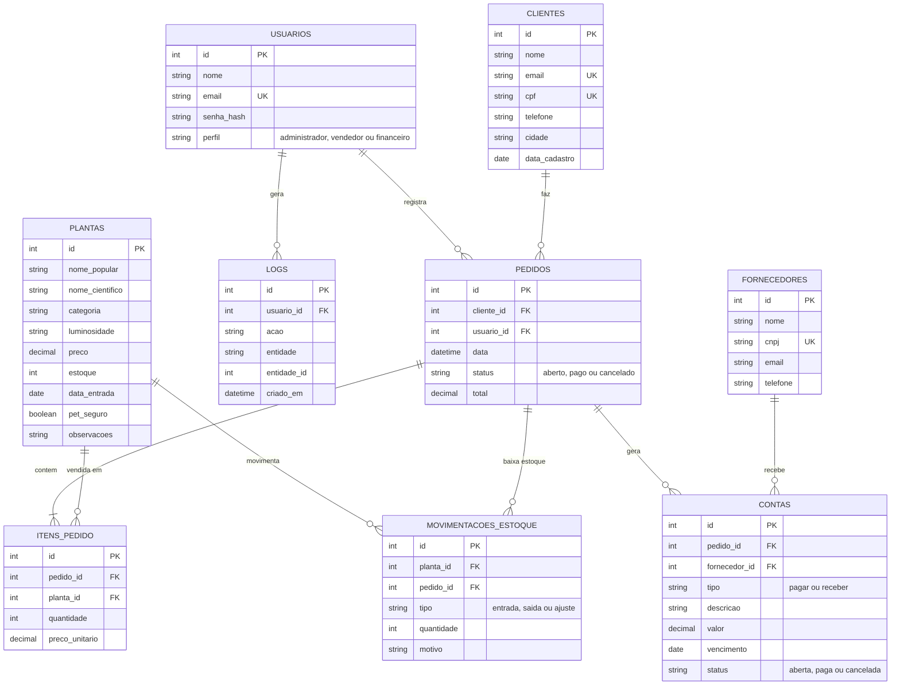

# Diagrama entidade-relacionamento

Pode ser visualizado no GitHub (renderiza Mermaid) ou colando o código em https://mermaid.live para exportar como imagem.
O script completo está em `api/schema.sql`.

